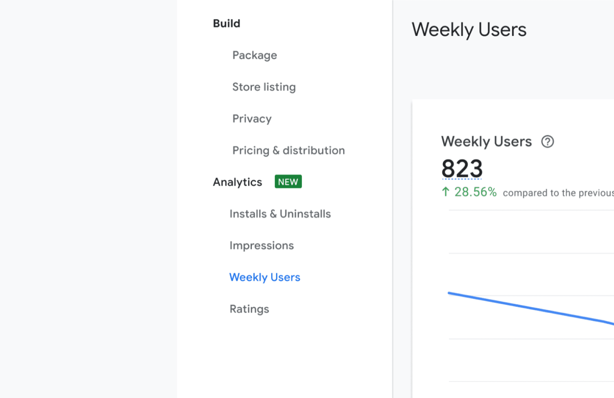
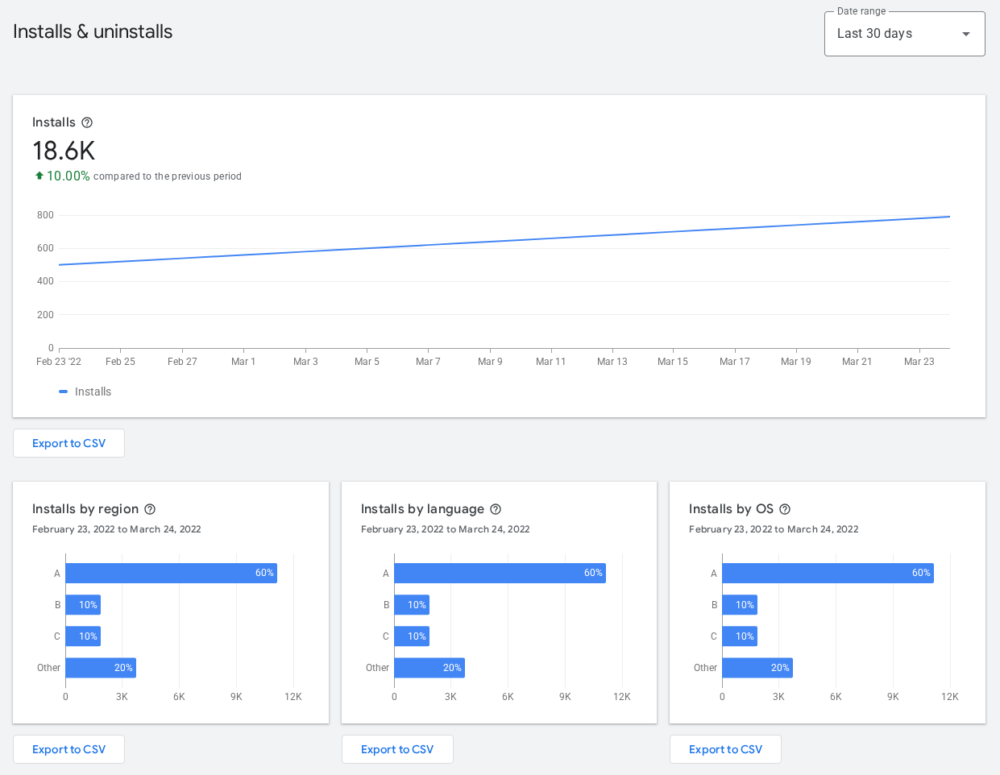
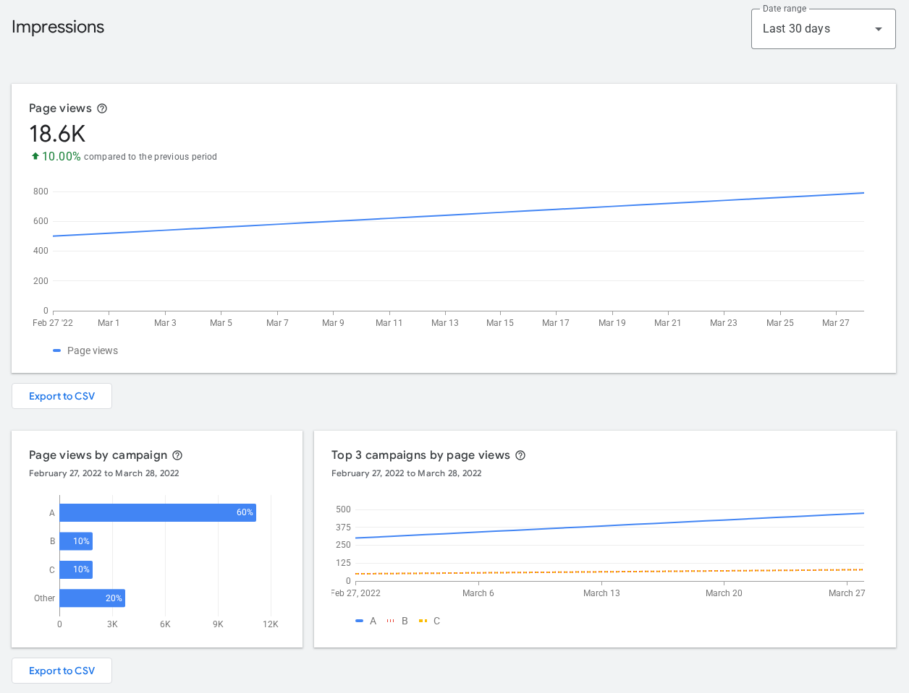
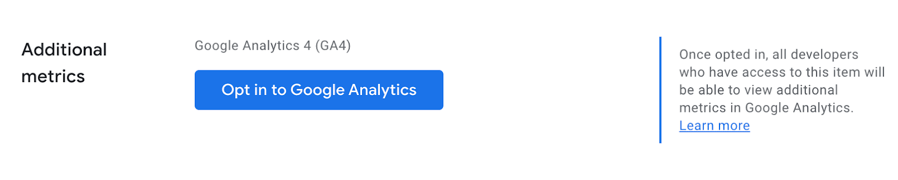
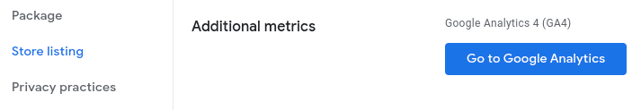
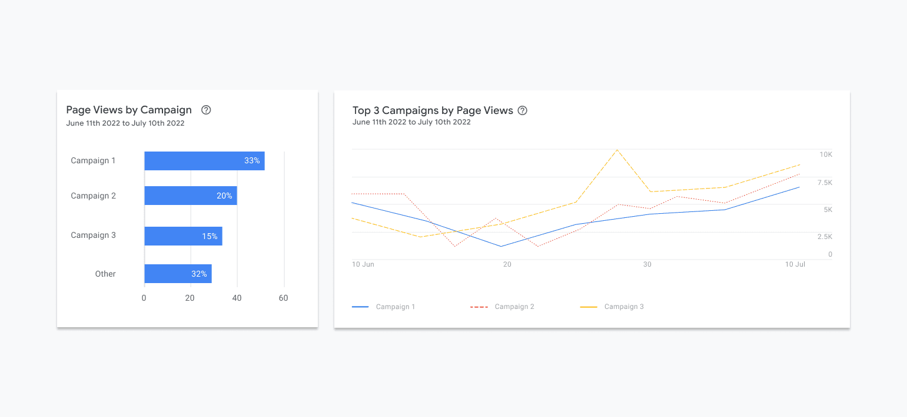

# Dashboard của Chrome Web Store có những gì

Trang này là bản đồ: mỗi biểu đồ trong mục **Analytics** của Developer Dashboard đếm cái gì, đếm theo đơn vị nào, và
lỗi đọc hay gặp. Các trang sau đi sâu từng phần.

## Vào đâu để xem

1. Mở [Chrome Web Store Developer Dashboard](https://chrome.google.com/webstore/devconsole).
2. Chọn extension → cột trái chọn **Analytics**.
3. Mỗi khối có ô **Date range** (7 / 30 / 90 ngày…), nút ⓘ giải thích định nghĩa, và nút **Export to CSV**.
4. Nút **View more metrics on Google Analytics** mở GA4 do Chrome Web Store quản lý giùm bạn (xem cuối trang).

*Ảnh: [Google, Revamping Analytics (2022)](https://developer.chrome.com/blog/cws-analytics-revamp), CC BY 4.0. Cột trái: nhóm **Analytics** gồm Installs & Uninstalls, Impressions, Weekly Users, Ratings.*

Tên khối có thể đổi chút theo đợt cập nhật dashboard; định nghĩa bên dưới lấy từ
[tài liệu chính thức](https://developer.chrome.com/docs/webstore/metrics) và
[bài giới thiệu dashboard mới](https://developer.chrome.com/blog/cws-analytics-revamp) của Google.

## Bảng tra: từng chỉ số nghĩa là gì

| Chỉ số | Nghĩa là | Đếm theo | Dùng để trả lời |
|---|---|---|---|
| **Installs** | Số lượt cài mới mỗi ngày (cả người mới và người cài lại) | Tài khoản / người dùng Chrome ¹ | Có bao nhiêu người mới đến? (acquisition) |
| **Uninstalls** | Số lượt gỡ mỗi ngày | Trình duyệt ¹ | Có bao nhiêu người bỏ đi? (churn) |
| **Weekly users** | Số trình duyệt đã tải extension trong 7 ngày qua | Trình duyệt ¹ | Thực sự đang có bao nhiêu chỗ chạy extension? |
| **Enabled vs Disabled** | Trong các bản đang cài, bao nhiêu bật / bao nhiêu tắt | Bản cài | User còn muốn dùng hay chỉ để đó? |
| **… by region** | Tỷ lệ % theo quốc gia | — | Thị trường nào mang user về? |
| **… by language** | Tỷ lệ % theo ngôn ngữ cài đặt của Chrome | — | Nên dịch listing sang tiếng nào? |
| **… by OS** | Tỷ lệ % theo hệ điều hành (Windows, macOS, ChromeOS, Linux) | — | Test và chụp ảnh trên máy nào trước? |
| **… by item version** | User đang ở phiên bản nào của extension | — | Bản cập nhật mới đã tới tay user chưa? |
| **Impressions** | Số lần extension hiện ra khi người ta tìm kiếm, duyệt danh mục, collection, hoặc vào thẳng trang | Lượt hiển thị | Listing có được nhìn thấy không? |
| **Page views** (trong GA4) | Lượt xem trang listing của bạn | Lượt xem | Bao nhiêu người bấm vào xem chi tiết? |
| **install event** (trong GA4) | Sự kiện cài, chỉ gửi khi user **bấm đồng ý** hộp thoại quyền | Sự kiện | Tỷ lệ xem trang → cài (conversion) |

¹ Theo phân tích của [Extension Ranker](https://extensionranker.com/blog/how-chrome-web-store-metrics-work)
(nguồn bên thứ ba, Google không ghi rõ): installs đếm theo người dùng, còn uninstalls và weekly users đếm theo trình
duyệt. Một người bật Chrome Sync trên 4 máy có thể chỉ tính **1 install** nhưng **4 uninstalls** khi gỡ ở cả 4 máy.

## Ba trang Analytics trông thế nào

Google tách mục Analytics thành 3 trang. Trang nào cũng có cùng bố cục: **một biểu đồ chính** ở trên (con số to + % so với kỳ trước), **các biểu đồ phân nhóm** ở dưới, và nút **Export to CSV** dưới từng khối.

**1. Installs & uninstalls**: biểu đồ installs theo ngày, rồi installs theo region / language / OS.

*Ảnh: [Google, Analyze your store listing](https://developer.chrome.com/docs/webstore/metrics), CC BY 4.0. Số trong ảnh là dữ liệu mẫu của Google, không phải extension thật.*

**2. Impressions**: biểu đồ chính là **Page views** (lượt xem trang listing), dưới là page views theo campaign.

*Ảnh: [Google, Analyze your store listing](https://developer.chrome.com/docs/webstore/metrics), CC BY 4.0. Số trong ảnh là dữ liệu mẫu của Google, không phải extension thật.*

**3. Users**: weekly users theo thời gian, theo region / language / OS, theo **item version** (cột chồng màu) và **Enabled vs disabled** (biểu đồ tròn).

*Ảnh: [Google, Analyze your store listing](https://developer.chrome.com/docs/webstore/metrics), CC BY 4.0. Số trong ảnh là dữ liệu mẫu của Google, không phải extension thật.*

## 4 lỗi đọc hay gặp

1. **Lấy installs trừ uninstalls rồi coi là số user.** Không đúng. Hai số đếm theo đơn vị khác nhau, và có người cài
   từ trước khung ngày đang xem. Muốn biết số user, nhìn **Weekly users**.
2. **Coi Weekly users là "người đang dùng tích cực".** Google ghi rõ số này chỉ phản ánh bản cài đã được tải, không
   đo user có thật sự dùng tính năng hay không. Muốn đo dùng thật, bạn phải tự gắn analytics trong extension.
3. **So % giữa hai biểu đồ khác gốc.** Ví dụ bên dưới: biểu đồ region có trục tới ~50, biểu đồ language trục chỉ tới
   ~10. Cùng là "70%" nhưng có thể không cùng mẫu số. Luôn bấm ⓘ xem biểu đồ đó đếm gì, kỳ nào.
4. **Hoảng vì một ngày bằng 0 hoặc một ngày vọt lên.** Với extension nhỏ (vài lượt/ngày) dao động 0–4 là bình thường.
   Nhìn tổng 7 ngày và 30 ngày, đừng nhìn một ngày.

## Đọc thử một dashboard thật

Ảnh chụp dashboard một extension nhỏ, kỳ **23/9 – 22/10/2026**:

| Dashboard ghi | Đọc ra |
|---|---|
| **Installs: 68**, ↑ **25.93%** so với kỳ trước | Kỳ trước khoảng 68 / 1.2593 ≈ **54** installs. Tăng thật, khoảng +14 lượt. Trung bình **~2.3 installs/ngày** |
| Đường biểu đồ dao động 1–4, ngày cuối vọt lên **8** | Ngày cuối gấp ~3,5 lần trung bình → có sự kiện: một bài đăng, một lượt được nhắc tên, một đợt lên hạng tìm kiếm. **Tìm ra nguyên nhân và lặp lại nó** |
| **Region:** United States 70%, Japan, Kenya, Other 5% | Mỹ mang về ~48/68 installs. Thị trường chính rõ ràng là Mỹ; Nhật đáng để ý (xem [trang 03](03-region-language-os.md)) |
| **Language:** English (United States) 71%, English (United Kingdom), Spanish | Gần như toàn bộ đọc tiếng Anh. Chưa cần dịch listing; nếu dịch thì tiếng Nhật / Tây Ban Nha trước |
| Ảnh chưa có Uninstalls và Weekly users | **Chưa kết luận được sức khỏe.** Installs tăng mà uninstalls tăng nhanh hơn thì vẫn là đang mất user. Xem tiếp [trang 02](02-installs-uninstalls.md) |

## Google Analytics của Chrome Web Store

Trong tab **Store listing → Additional metrics** bạn bật GA4 cho trang listing. Theo
[hướng dẫn chính thức](https://developer.chrome.com/docs/webstore/google-analytics):

- Chrome Web Store tạo và quản lý property GA4 giùm bạn; bạn chỉ thấy dữ liệu tổng hợp, không thấy từng người.
- Có **page view** cho mỗi lượt xem listing và sự kiện **install** (đánh dấu được thành key event / conversion).
- Dữ liệu chỉ giữ **2 tháng**. Muốn so sánh dài hạn thì phải [export CSV](05-export-csv.md) định kỳ.

Nút bật nằm cuối tab **Store listing**, mục **Additional metrics**. Bật rồi thì nút đổi thành **Go to Google Analytics**:

*Ảnh: [Google, Google Analytics for your store listing](https://developer.chrome.com/docs/webstore/google-analytics), CC BY 4.0.*

*Ảnh: [Google, Analyze your store listing](https://developer.chrome.com/docs/webstore/metrics), CC BY 4.0.*

### Page views theo campaign: biết bài đăng nào mang người tới

Gắn tham số UTM vào link trỏ về listing (ví dụ `?utm_source=reddit&utm_campaign=launch`), trang **Impressions** sẽ tách page views theo `utm_source`, `utm_medium`, `utm_campaign` ([Google](https://developer.chrome.com/blog/cws-analytics-revamp)). Mỗi bài đăng một link UTM riêng là biết ngay bài nào kéo được người xem.

*Ảnh: [Google, Revamping Analytics (2022)](https://developer.chrome.com/blog/cws-analytics-revamp), CC BY 4.0. Số trong ảnh là dữ liệu mẫu của Google, không phải extension thật.*

Đây là chỗ duy nhất trả lời câu "100 người xem trang, bao nhiêu người cài?". Nếu tỷ lệ này thấp, vấn đề nằm ở
listing (ảnh, mô tả), không nằm ở sản phẩm: xem [listing-browser-extension](../../skills/listing/listing-browser-extension/SKILL.md).
