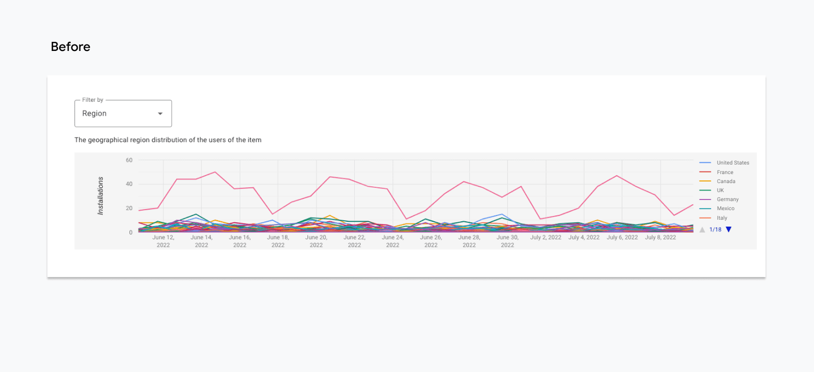
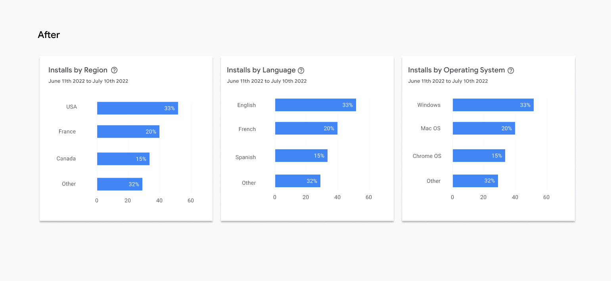
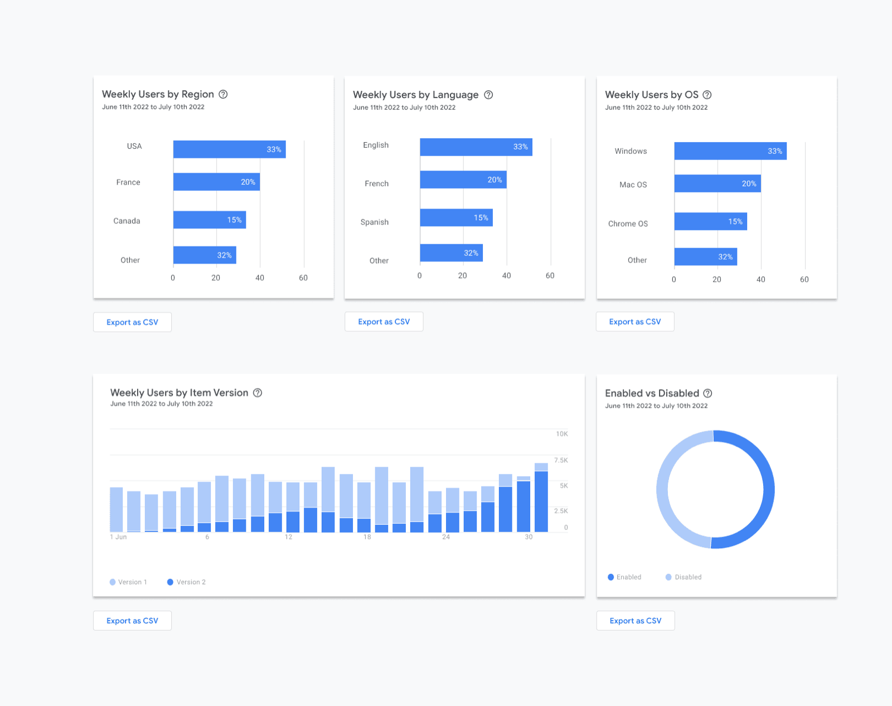
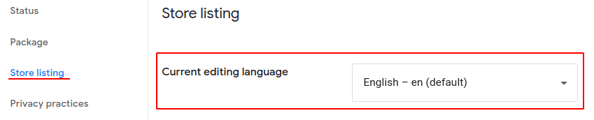
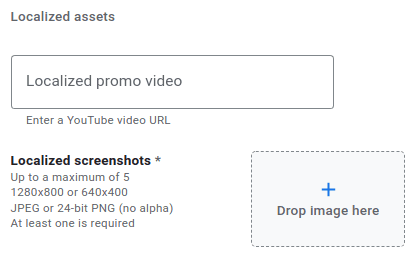

# Region, language, OS: user ở đâu, nói tiếng gì, dùng máy gì

Ba biểu đồ phân nhóm cùng một tập user theo ba cách. Dashboard hiện **top nhóm dưới dạng % tổng installs** trong kỳ
([Google](https://developer.chrome.com/blog/cws-analytics-revamp)), phần còn lại gộp vào **Other**.

Từ 2022 Google bỏ kiểu biểu đồ cũ (hàng chục đường chồng nhau, không đọc nổi) và chuyển sang thanh ngang %:

*Ảnh: [Google, Revamping Analytics (2022)](https://developer.chrome.com/blog/cws-analytics-revamp), CC BY 4.0.*

*Ảnh: [Google, Revamping Analytics (2022)](https://developer.chrome.com/blog/cws-analytics-revamp), CC BY 4.0.*

Ở trang **Users** cũng có đủ ba biểu đồ này, cộng thêm **item version** và **Enabled vs Disabled**:

*Ảnh: [Google, Revamping Analytics (2022)](https://developer.chrome.com/blog/cws-analytics-revamp), CC BY 4.0. Số trong ảnh là dữ liệu mẫu của Google, không phải extension thật. Ví dụ đọc: USA 33%, Windows 33%, Mac OS 20%, Chrome OS 15%.*

## Installs by region: user ở quốc gia nào

**Là gì:** tỷ lệ % installs theo quốc gia của người cài.

**Dùng để:**

- **Biết thị trường chính.** 70% Mỹ nghĩa là listing, ảnh chụp, ví dụ, giờ đăng bài trên mạng xã hội nên theo người Mỹ.
- **Định giá.** Nếu sau này thu phí, nước có user quyết định mức giá và cổng thanh toán (xem
  [monetization-payment-setup](../../skills/monetization/monetization-payment-setup/SKILL.md)).
- **Phát hiện kênh lạ.** Một nước bất ngờ nổi lên (ví dụ Kenya trong ảnh dashboard ở [trang 01](01-doc-dashboard.md))
  thường do một bài viết, một nhóm cộng đồng, một trường học hoặc một video ở nước đó. Tìm ra nguồn: đó có thể là kênh miễn phí.

**Ưu tiên thế nào:** chọn **1 thị trường chính** để làm mọi thứ theo, và **1 thị trường thứ hai** để thử dịch listing.
Thị trường thứ hai nên là nước đã có user tự tìm đến (như Nhật trong ví dụ) chứ không phải nước bạn đoán.

## Installs by language: user đọc tiếng gì

**Là gì:** ngôn ngữ cài đặt của trình duyệt Chrome, **không phải** quốc tịch. Một người Việt ở Mỹ dùng Chrome tiếng
Anh sẽ tính là English (United States). English (United States) và English (United Kingdom) được tách riêng.

**Dùng để:**

- **Quyết định dịch listing.** Chrome Web Store cho mỗi ngôn ngữ một tên + mô tả + ảnh riêng. Nếu một ngôn ngữ chiếm
  ≥ 5–10% installs mà listing chưa có bản tiếng đó, dịch nó là việc rẻ nhất để tăng installs.
- **Viết listing đúng giọng.** 71% English (US) → viết "color", "organize", ví dụ bằng đô la.
- **So với region.** Region Nhật nhưng language English? User Nhật đó dùng Chrome tiếng Anh, chưa cần dịch.

**Dịch ở đâu:** trong tab **Store listing**, chọn ngôn ngữ ở đầu trang rồi điền mô tả, và tải **ảnh chụp riêng cho ngôn ngữ đó** (tối đa 5 ảnh, 1280×800 hoặc 640×400) ([Google](https://developer.chrome.com/docs/webstore/cws-dashboard-listing)):

*Ảnh: [Google, Complete your listing information](https://developer.chrome.com/docs/webstore/cws-dashboard-listing), CC BY 4.0.*

*Ảnh: [Google, Complete your listing information](https://developer.chrome.com/docs/webstore/cws-dashboard-listing), CC BY 4.0.*

## Installs by OS: user dùng máy gì

**Là gì:** tỷ lệ % installs theo hệ điều hành: Windows, macOS, ChromeOS, Linux.

Mốc so sánh: theo [StatCounter](https://gs.statcounter.com/os-market-share/desktop/worldwide) tháng 6/2026, trên web
desktop toàn cầu Windows ~56,6%, macOS ~16,4% (OS X 11,89% + macOS 4,48%), Linux ~4,4%, ChromeOS ~1,2%, không xác
định ~21,5%. StatCounter đo lượt xem web, không đo máy đã bán. Nếu tỷ lệ OS của bạn lệch hẳn mốc này, đó là đặc
điểm của nhóm user bạn đang có.

| OS | Lợi thế | Khi OS này nhiều hơn mốc chung, nghĩa là |
|---|---|---|
| **Windows** | Đông nhất; nguồn installs chính của hầu hết extension | Bình thường. Ảnh chụp và phím tắt (Ctrl) nên theo Windows |
| **macOS** | Nhóm lớn thứ hai; hay gặp ở designer, developer, người làm sáng tạo | Ảnh listing nên có bản Mac, phím tắt ghi ⌘. Đáng thử thu phí sớm, nhưng kiểm bằng số của chính bạn |
| **ChromeOS** | Chromebook phổ biến ở trường học và doanh nghiệp | Extension của bạn có thể đang được dùng ở lớp học / văn phòng: danh mục Education, cài hàng loạt qua admin |
| **Linux** | Nhỏ, chủ yếu dân kỹ thuật | Hợp với extension Developer Tools; user này hay báo lỗi chi tiết và góp code |

**Trên dashboard trông thế nào:** một biểu đồ thanh ngang, mỗi thanh là một OS, ghi % installs trong khung ngày bạn
chọn. Chỉ hiện vài OS lớn nhất, còn lại gộp vào **Other**.

> **Illustrative example.** Hai extension giả định, cùng 30 ngày, đọc biểu đồ OS như sau:
>
> | OS | Extension A (chụp màn hình web) | Extension B (luyện gõ phím) | Mốc StatCounter |
> |---|---|---|---|
> | Windows | 52% | 31% | ~56,6% |
> | macOS | 38% | 6% | ~16,4% |
> | ChromeOS | 3% | **58%** | ~1,2% |
> | Linux | 7% | 5% | ~4,4% |
>
> - **A:** macOS gấp hơn 2 lần mốc chung → nhiều designer / dev dùng Mac. Chụp ảnh listing trên Mac, ghi phím tắt ⌘.
> - **B:** ChromeOS 58%, gấp ~50 lần mốc chung → gần như chắc là học sinh dùng Chromebook ở trường. Viết listing cho
>   giáo viên, thêm danh mục Education, và tìm xem trường nào đang dùng để liên hệ.

**Ưu tiên thế nào:** test và sửa lỗi trên OS chiếm nhiều installs nhất trước. Nếu ChromeOS chiếm phần lớn bất
thường, đó là tín hiệu lớn: có thể một trường hoặc một công ty đang dùng, nên liên hệ họ.

## By item version (trong khối Users)

Cho biết user đang chạy phiên bản nào. Sau khi phát hành bản mới, theo dõi bao lâu thì bản mới chiếm đa số. Nếu một
bản cũ cứ nằm lại với tỷ lệ lớn, có thể bản mới xin thêm quyền và user chưa bấm đồng ý (extension bị tắt chờ duyệt).

## Đọc cả ba cùng lúc

| Region | Language | OS | Gợi ý |
|---|---|---|---|
| Mỹ cao | English (US) cao | Windows cao | Bình thường; tập trung vào listing tiếng Anh và kênh ở Mỹ |
| Một nước cao bất thường | Tiếng nước đó | ChromeOS cao | Gần như chắc là trường học / tổ chức ở nước đó đang dùng |
| Nhiều nước rải rác | Nhiều ngôn ngữ | — | Extension giải quyết nhu cầu chung; dịch listing sang 2–3 tiếng lớn nhất |
