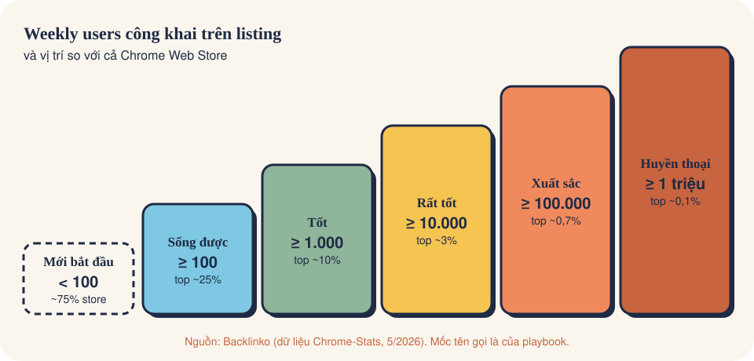

# Sức khỏe extension: chấm điểm trong 5 phút mỗi tuần

Một trang để trả lời hai câu: **extension đang khỏe hay yếu**, và **nó đang đứng ở đâu so với cả Chrome Web Store**.

## Bảng chấm điểm 6 chỉ số

Mỗi dòng cho 0, 1 hoặc 2 điểm. Mốc là **quy tắc kinh nghiệm của playbook**, Google không công bố chuẩn; quan trọng
nhất là so với chính bạn tháng trước.

| # | Chỉ số | Lấy ở đâu | 2 điểm 🟢 | 1 điểm 🟡 | 0 điểm 🔴 |
|---|---|---|---|---|---|
| 1 | Installs 30 ngày so với kỳ trước | Installs & uninstalls | tăng > 10% | ±10% | giảm > 10% |
| 2 | Uninstall / install 30 ngày | Installs & uninstalls | < 30% | 30–60% | > 60% |
| 3 | Weekly users so với 4 tuần trước | Users | tăng > 2% | ±2% | giảm > 2% |
| 4 | Tỷ lệ Enabled | Users → Enabled vs Disabled | > 90% | 75–90% | < 75% |
| 5 | Điểm rating và review mới | Ratings & reviews | ≥ 4.5 và có review mới | 4.0–4.4 | < 4.0 hoặc review 1 sao mới chưa trả lời |
| 6 | Xem trang → cài (nếu bật GA4) | Google Analytics: install ÷ page views | tăng hoặc giữ | giảm nhẹ | giảm mạnh sau khi đổi listing |

**Tổng điểm:** 9–12 🟢 **Khỏe** · 5–8 🟡 **Cần theo dõi** · 0–4 🔴 **Đáng lo**. Chỉ số nào chưa có dữ liệu thì bỏ, tính
theo phần trăm số điểm tối đa còn lại.

Chỉ số 3 và 4 nằm cùng một trang **Users**: đường weekly users ở trên, vòng tròn **Enabled vs disabled** ở góc dưới phải.

*Ảnh: [Google, Analyze your store listing](https://developer.chrome.com/docs/webstore/metrics), CC BY 4.0. Số trong ảnh là dữ liệu mẫu của Google, không phải extension thật.*

Cần chi tiết từng bậc users và ví dụ thật: [Extension tốt có bao nhiêu users](06-extension-tot-bao-nhieu-users.md).

Điểm thấp ở dòng nào thì xem lại đúng phần đó: dòng 1 là **kênh**, dòng 2–4 là **sản phẩm / onboarding**, dòng 5 là
**chất lượng + chăm sóc user**, dòng 6 là **listing**.

## Extension của bạn đang đứng ở đâu

Chrome Web Store rất "đuôi dài": phần lớn extension gần như không có user. Theo số liệu bên thứ ba của
[Exstats](https://exstats.com/blog/state-of-browser-extensions-q2-2026) (tự crawl store, không phải số của Google):

| Mốc | Số liệu | Nguồn |
|---|---|---|
| Extension ở giữa (median) có | **14 users** | Exstats, báo cáo Q2/2026 |
| Extension có ≤ 100 users | **70,4%** store | Exstats, 3/2026 |
| Extension có > 10.000 users | **2,63%** store | Exstats, 3/2026 |

Từ đó ra **thang vị trí** (dùng con số "users" công khai trên trang listing của bạn):

| Bạn có | Vị trí tương đối |
|---|---|
| dưới 15 users | Nửa dưới của store |
| 15–100 users | Đã hơn một nửa store, nhưng vẫn trong nhóm 70% "nhỏ" |
| 100–10.000 users | Nhóm khoảng 27% ở giữa: có sản phẩm thật, có người dùng thật |
| trên 10.000 users | Top ~2,6% |

Muốn so với **đối thủ cùng ngách** thì xem số users công khai trên trang listing của họ, hoặc dùng công cụ theo dõi
như [Exstats](https://exstats.com/) / [Chrome-Stats](https://chrome-stats.com/) để xem lịch sử tăng trưởng của họ.

## Thói quen 5 phút mỗi tuần

1. Cùng một ngày mỗi tuần, mở Analytics, để **Date range = 30 ngày**.
2. Ghi 6 chỉ số trên vào một bảng (Google Sheets hoặc file CSV).
3. Export CSV Installs, Uninstalls, Weekly users ([trang 05](05-export-csv.md)) và chạy script chấm điểm.
4. Có ngày vọt lên hay tụt xuống? Ghi một dòng "vì sao" (bài đăng, bản cập nhật, review mới…).
5. Chọn **một** việc cho tuần tới theo dòng có điểm thấp nhất.

## Ví dụ thật: chấm extension ở trang 01

| # | Chỉ số | Số liệu | Điểm |
|---|---|---|---|
| 1 | Installs 30 ngày | 68, +25.93% | 2 🟢 |
| 2 | Uninstall / install | chưa có trong ảnh | — |
| 3 | Weekly users | chưa có trong ảnh | — |
| 4–6 | Enabled, rating, conversion | chưa có trong ảnh | — |

Mới có 1/6 chỉ số nên **chưa đủ để kết luận**. Kênh kéo người đang tốt lên; việc tiếp theo là mở khối Uninstalls và
Users cùng kỳ. Đây chính là lý do của chuyên mục này: một con số "tăng 25%" chưa nói lên sức khỏe.
