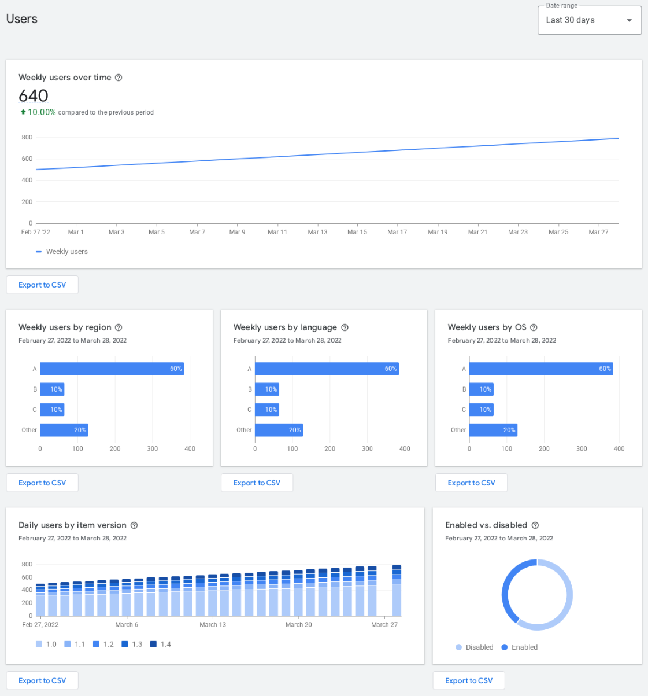

# Export CSV: vì sao nên tải số liệu về

Mỗi biểu đồ trong Analytics có nút **Export to CSV**
([Google](https://developer.chrome.com/blog/cws-analytics-revamp)). Bấm mất 2 giây, nhưng nhiều người không bao giờ bấm.


*Ảnh: [Google, Analyze your store listing](https://developer.chrome.com/docs/webstore/metrics), CC BY 4.0. Nút **Export to CSV** nằm dưới **từng** khối, không có nút tải tất cả một lần. Số trong ảnh là dữ liệu mẫu của Google, không phải extension thật.*

## 6 lợi ích

| # | Lợi ích | Vì sao quan trọng |
|---|---|---|
| 1 | **Giữ lịch sử** | Dashboard chỉ xem được trong các khung ngày có sẵn, còn GA4 của store chỉ giữ dữ liệu **2 tháng** ([Google](https://developer.chrome.com/docs/webstore/google-analytics)). Không tải về thì không so được năm nay với năm ngoái |
| 2 | **Thấy số chính xác** | Biểu đồ chỉ cho hình dáng; file cho đúng số từng ngày, từng nước |
| 3 | **Đặt installs và uninstalls cạnh nhau** | Dashboard để hai biểu đồ riêng. Trong một bảng bạn tính được tỷ lệ uninstall / install, net, trung bình 7 ngày |
| 4 | **Gắn sự kiện vào ngày** | Thêm cột "ghi chú": ngày đăng Reddit, ngày ra bản 1.3, ngày đổi ảnh listing. Sau vài tháng bạn biết việc nào thật sự kéo installs |
| 5 | **Đưa cho AI hoặc người khác đọc** | Dán CSV vào Claude / ChatGPT / Sheets thay vì chụp ảnh màn hình; AI đọc số chính xác hơn đọc ảnh |
| 6 | **Tự động chấm sức khỏe** | Chạy script bên dưới mỗi tuần thay vì tính tay |

## Nên export những gì

Mỗi tuần (hoặc mỗi tháng), cùng khung **30 ngày**:

- `installs.csv`: Installs (tổng, hoặc theo region).
- `uninstalls.csv`: Uninstalls.
- `weekly-users.csv`: Weekly users.
- Mỗi tháng một lần: các bản theo region / language / OS, để thấy thị trường thay đổi.

Đặt tên có ngày: `2026-10-22-installs.csv`. Lưu cùng một thư mục.

## Script chấm điểm tự động

[`scripts/chrome_health.py`](scripts/chrome_health.py), chỉ cần Python 3, không cần cài gì thêm:

```bash
python3 chrome_health.py --installs installs.csv --uninstalls uninstalls.csv --users weekly-users.csv
```

Script không phụ thuộc tên cột: dòng nào có một ô ngày thì các ô số còn lại được cộng thành tổng ngày đó, nên file theo
từng nước cũng đọc được. Nó in ra installs 30 / 7 ngày so với kỳ trước, uninstalls, net, tỷ lệ uninstall / install,
xu hướng weekly users, ngày đột biến, và một kết luận 🟢 / 🟡 / 🔴 theo các mốc ở [trang 04](04-suc-khoe-extension.md).

> **Illustrative example.** Kết quả với dữ liệu mẫu tự tạo (không phải extension thật):
>
> ```
> Installs 30 ngày    : 63 (kỳ trước: 54, +16.7%)
> Installs 7 ngày     : 21 (7 ngày trước đó: 17, +23.5%)
> Uninstalls 30 ngày  : 28
> Net 30 ngày         : +35
> Uninstall / install : 44%
> Weekly users        : 159 (so với ~4 tuần trước: +21.4%)
> Ngày cao nhất       : 2026-10-22 = 10 installs (trung bình 2.1/ngày) ← đột biến, tìm nguyên nhân
> Kết luận            : 🟢 Khỏe
> ```

Nếu script báo "không tìm thấy dòng nào có ngày", mở file xem cột ngày đang ở dạng gì và gửi issue kèm 2 dòng đầu
(không cần số thật) để thêm định dạng đó.

## Prompt để AI đọc CSV giùm

````text
Đây là 3 file CSV export từ Chrome Web Store Developer Dashboard của extension tôi: installs, uninstalls, weekly users
(30 ngày gần nhất). Hãy:
1. Tính installs 30 ngày, uninstalls 30 ngày, tỷ lệ uninstall/install, xu hướng weekly users so với 4 tuần trước.
2. Chỉ ra ngày nào bất thường (cao hoặc thấp gấp 3 lần trung bình) và hỏi tôi chuyện gì xảy ra hôm đó.
3. Xếp extension vào một trong 7 tình huống: tăng trưởng thật / xô thủng / sản phẩm tốt thiếu khách / báo động /
   bản cập nhật có vấn đề / traffic sai đối tượng / đứng yên.
4. Đề xuất đúng 1 việc nên làm tuần tới.
Chỉ dùng số trong file, không tự bịa số. Trả lời bằng tiếng Việt.
````
