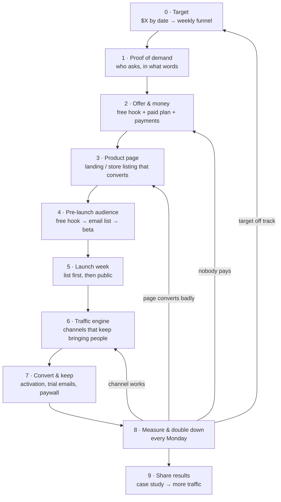
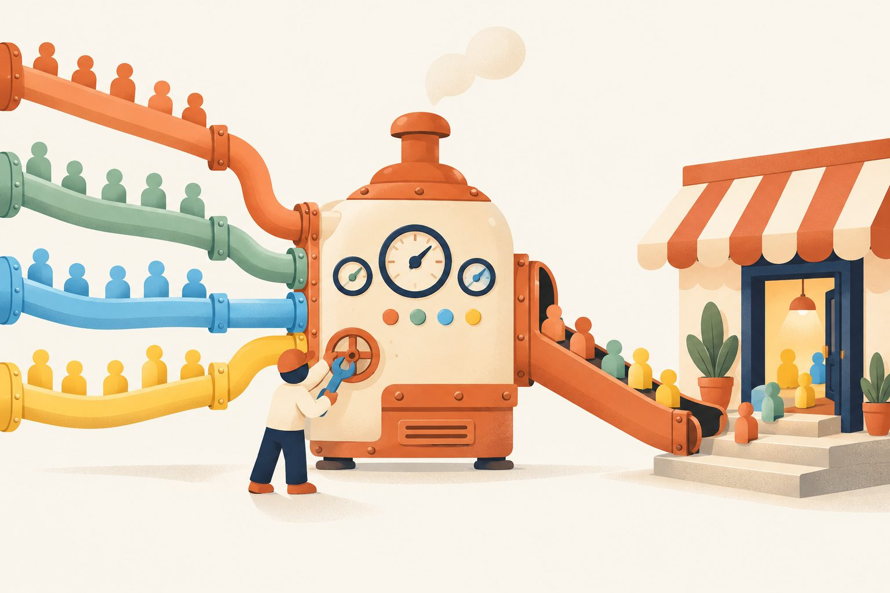

# Product Growth Hack: from 0 to the first sale


**Sales on opening day come from people who said "yes, I want this" before opening day.**
You can have the Pro version, the landing page, payments and every subscription plan ready, and still sell nothing,
because nobody is looking yet. This flow puts every step in order, from "nobody knows it exists" to "it sells every
week", and points each step to a skill in this repo.

```text
attention  →  free value  →  email / account  →  activation  →  offer with a deadline  →  paid  →  referral
 (traffic)    (trial, lite,     (you can reach       (the "wow"      (launch day)             (first      (next
              free tool)        them again)          moment)                                  sale)       traffic)
```

> Want the whole library as chapters instead of a route? See the [Growth Map](../playbooks/growth-map.md).
> Launching in 6 weeks with dated tasks? See [Launch a Product](../playbooks/launch-a-product.md). This file is the
> **order of operations** that sits above both: what to do first, what to do next, and when to move on.

---

## The answer first: everything is ready, what's step one?


You don't open sales first. **You give something away first, where your buyers already hang out, and collect a way to
reach them again.** Then you open sales to that list with a reason to buy now.

| # | Step | What it looks like | Skill |
|---|---|---|---|
| 1 | **Pick the free hook** | A free trial, a free Lite version, or one free mini-tool that solves a small piece of the problem. It must give a result in under 5 minutes | [monetization-free-trial-vs-freemium](../skills/monetization/monetization-free-trial-vs-freemium/SKILL.md) · [strategy-product-as-funnel](../skills/strategy/strategy-product-as-funnel/SKILL.md) |
| 2 | **Gate it with an email, not a card** | "Get the free version / early access" → email → download link. That email is the real asset, not the download | [email-list-and-deliverability](../skills/email/email-list-and-deliverability/SKILL.md) |
| 3 | **Go where buyers already ask** | 3 places only: one subreddit, one Facebook group, X replies. Answer questions, show the result, link only when it fits the rules | [research-where-users-ask](../skills/research/research-where-users-ask/SKILL.md) → [launch-reddit-posting](../skills/launch/launch-reddit-posting/SKILL.md) · [social-credible-posting](../skills/social/social-credible-posting/SKILL.md) · [social-x-reply](../marketing/x-marketing/skills/social-x-reply/SKILL.md) |
| 4 | **Turn free users into beta testers** | Invite the most active 10–30 people to a private beta: they get the Pro version free, you get feedback, quotes and screenshots | [email-beta-program](../skills/email/email-beta-program/SKILL.md) |
| 5 | **Warm the list for 7–14 days** | One email or post every few days: what you built, a 30-second demo, a tester's result. No selling yet | [social-build-in-public](../skills/social/social-build-in-public/SKILL.md) · [social-short-video](../skills/social/social-short-video/SKILL.md) |
| 6 | **Open sales to the list first** | "Founding member" price or bonus, for a fixed number of days. The list hears it 24–48 h before the public | [monetization-pricing-strategy](../skills/monetization/monetization-pricing-strategy/SKILL.md) · [email-trial-sequence](../skills/email/email-trial-sequence/SKILL.md) |
| 7 | **Then launch in public** | Product Hunt, Show HN, Reddit, directories, all on the same week, with testers ready to comment | [launch-post-writing](../skills/launch/launch-post-writing/SKILL.md) · [launch-product-hunt-launch](../skills/launch/launch-product-hunt-launch/SKILL.md) · [listing-free-directories](../skills/listing/listing-free-directories/SKILL.md) |

Example in one line: *a Mac cleaner app gives away a free "scan only" version on r/macapps and in X replies, asks for an
email to download, invites 20 heavy users to a free Pro beta, posts their before/after screenshots for 10 days, then
emails the list a 3-day founding price before the Product Hunt launch.*

> **Illustrative example.** The app, channels and numbers above show the shape of the flow; they are not results.

---

## The full flow



Each phase has a **gate**: the thing that must be true before you spend time on the next one. Skipping a gate is
the most common reason a launch gets traffic and no sales.

---

## Phase 0 · Set the target

| | |
|---|---|
| Goal | Know how many visitors, trials and buyers you need, per week |
| Do | Write "$X by <date>". Work backward to buyers → trials → visitors. Pick the one channel that can deliver most of it |
| Skills | [strategy-revenue-target](../skills/strategy/strategy-revenue-target/SKILL.md) → [strategy-spend-and-timing](../skills/strategy/strategy-spend-and-timing/SKILL.md) |
| Output | `growth/revenue-target.md` |
| Gate ✅ | You can say: "I need N visitors a week at about Y% to trial" (use your own guess, mark it as a guess) |

## Phase 1 · Proof of demand

| | |
|---|---|
| Goal | Know who wants it, where they ask, and the exact words they use |
| Do | Find 10 threads where people ask for this. Read 50 competitor reviews. Tear down 3 competitors |
| Skills | [research-where-users-ask](../skills/research/research-where-users-ask/SKILL.md) → [research-review-mining](../skills/research/research-review-mining/SKILL.md) → [case-study-competitor-teardown](../skills/case-study/case-study-competitor-teardown/SKILL.md) · [strategy-contrarian-marketing](../skills/strategy/strategy-contrarian-marketing/SKILL.md) |
| Output | `research/` with the top 3 pains in users' own words, a list of 10–20 places they gather |
| Gate ✅ | You can write the headline using a phrase a real user wrote |

## Phase 2 · Offer and money

| | |
|---|---|
| Goal | A free hook that pulls people in, and a paid plan that's easy to say yes to |
| Do | Choose trial / freemium / reverse trial. Set prices and 2–3 tiers. Get a payment provider approved and make one real test purchase |
| Skills | [monetization-free-trial-vs-freemium](../skills/monetization/monetization-free-trial-vs-freemium/SKILL.md) → [monetization-pricing-strategy](../skills/monetization/monetization-pricing-strategy/SKILL.md) → [monetization-subscription-tiers](../skills/monetization/monetization-subscription-tiers/SKILL.md) → [monetization-payment-setup](../skills/monetization/monetization-payment-setup/SKILL.md) · apps: [monetization-in-app-purchase-setup](../skills/monetization/monetization-in-app-purchase-setup/SKILL.md) → [monetization-paywall-design](../skills/monetization/monetization-paywall-design/SKILL.md) |
| Output | `growth/pricing.md`, a founding / launch offer with an end date, a test receipt |
| Gate ✅ | A stranger can go from "free" to "paid" without talking to you |

## Phase 3 · Product page that converts

| | |
|---|---|
| Goal | Every visitor lands on a page that says what it does, for whom, and what to do next, in 5 seconds |
| Do | One page per product. Above the fold: headline from Phase 1, a 15–30 s demo, one button (free download / start trial), an email capture for people not ready. Tracking and UTM on every link |
| Skills | Web: [launch-pre-launch-checklist](../skills/launch/launch-pre-launch-checklist/SKILL.md) (landing page section) · stores: [listing-app-store](../skills/listing/listing-app-store/SKILL.md) / [listing-google-play](../skills/listing/listing-google-play/SKILL.md) + [aso-keyword-research](../skills/aso/aso-keyword-research/SKILL.md) → [aso-screenshot-strategy](../skills/aso/aso-screenshot-strategy/SKILL.md) · other niches: [listing README](../skills/listing/README.md) · tracking: [launch-growth-stack-setup](../skills/launch/launch-growth-stack-setup/SKILL.md) · learn from winners: [case-study-award-winning-design](../skills/case-study/case-study-award-winning-design/SKILL.md) |
| Output | Live page or submitted listing, events firing (visit → click → sign-up → trial → purchase) |
| Gate ✅ | You can see each funnel step as a number. No numbers = no launch |

## Phase 4 · Pre-launch audience (the step most people skip)

| | |
|---|---|
| Goal | A list of people who already tried the free hook before you announce anything |
| Do | Put the free hook in the 3 places from Phase 1. Post 3–5 times a week about the build. Invite the most active users to a beta. Collect quotes and before/after screenshots |
| Skills | [social-build-in-public](../skills/social/social-build-in-public/SKILL.md) · [social-credible-posting](../skills/social/social-credible-posting/SKILL.md) · X: [X Marketing kit](../marketing/x-marketing/README-X-Marketing.md) ([profile funnel](../marketing/x-marketing/skills/social-x-profile-funnel/SKILL.md), [daily flow](../marketing/x-marketing/flow/daily-flow.md), [real analytics pattern](../marketing/x-marketing/flow/analytics-pattern.md)) · [email-list-and-deliverability](../skills/email/email-list-and-deliverability/SKILL.md) → [email-beta-program](../skills/email/email-beta-program/SKILL.md) · open source: [launch-github-repo-seeding](../skills/launch/launch-github-repo-seeding/SKILL.md) · B2B: [email-cold-outreach](../skills/email/email-cold-outreach/SKILL.md) |
| Output | Email list + beta testers + 3–5 real quotes or screenshots you're allowed to use |
| Gate ✅ | A list big enough that your Phase 0 conversion guess gives you first buyers from the list alone |

## Phase 5 · Launch week

List first, public second. Run it as a calendar:

| Day | Do | Skill |
|---|---|---|
| T-7 | Posts written for every channel, Product Hunt page drafted, testers asked to be around on launch day | [launch-post-writing](../skills/launch/launch-post-writing/SKILL.md) · [launch-product-hunt-launch](../skills/launch/launch-product-hunt-launch/SKILL.md) |
| T-2 | Email the list: founding offer opens, ends on a set date | [email-trial-sequence](../skills/email/email-trial-sequence/SKILL.md) |
| T-0 | Public launch: Product Hunt / Show HN / Reddit / X / Facebook groups, plus Level 1 directories. Answer every comment | [launch-reddit-posting](../skills/launch/launch-reddit-posting/SKILL.md) · [listing-free-directories](../skills/listing/listing-free-directories/SKILL.md) |
| T+1 → T+7 | Fast channels for the first downloads | [launch-quick-download-wins](../skills/launch/launch-quick-download-wins/SKILL.md) |
| Offer end date | "Last day" email to people who started but didn't buy. Then really end it | [email-trial-sequence](../skills/email/email-trial-sequence/SKILL.md) |
| T+7 → T+30 | Personal outreach until 100 real users | [launch-get-first-100-users](../skills/launch/launch-get-first-100-users/SKILL.md) |

Gate ✅: first paid customers, and a log of **which channel brought buyers** (not just visits).

## Phase 6 · Traffic engine for product pages



After launch the spike drops. Build channels that keep sending people to the product page, one at a time, from fastest
to slowest-but-longest-lasting:

| Type | Channel | Speed | Lasts | Skill |
|---|---|---|---|---|
| Owned | Email list, X / Threads / Facebook profile | Days | Forever | [email-segments-and-tools](../skills/email/email-segments-and-tools/SKILL.md) · [social-x-growth](../marketing/x-marketing/skills/social-x-growth/SKILL.md) |
| Owned | Email signatures on every address, cross-links between all your profiles (Reddit, GitHub, stores, landing → X) | Days | Forever, small and steady | [cross-channel-funnel](../marketing/x-marketing/flow/cross-channel-funnel.md) |
| Earned | Reddit, Hacker News, forums, Facebook groups | Same day | Days | [launch-reddit-posting](../skills/launch/launch-reddit-posting/SKILL.md) · [research-where-users-ask](../skills/research/research-where-users-ask/SKILL.md) |
| Listed | Directories, alternative stores, AI / plugin marketplaces | Weeks | Months | [listing-free-directories](../skills/listing/listing-free-directories/SKILL.md) · [listing-ai-product](../skills/listing/listing-ai-product/SKILL.md) · [listing-dev-plugin](../skills/listing/listing-dev-plugin/SKILL.md) |
| Store search | App Store / Google Play / Chrome Web Store search | Weeks | Months–years | [Playbook: ASO Optimization](../playbooks/aso-optimization.md) |
| Video | TikTok, Reels, Shorts | Days | Weeks | [social-short-video](../skills/social/social-short-video/SKILL.md) |
| Owned | Instagram profile: carousels, Reels, Stories → bio link / Story link sticker | Days | Weeks per post, forever in Highlights | [Instagram kit](../marketing/instagram-marketing/README-Instagram-Marketing.md) · [image flow](../marketing/instagram-marketing/docs/04-image-flow.md) |
| Side door | Free tool, free template, free repo that points to the paid product | Weeks | Years | [launch-open-source-funnel](../skills/launch/launch-open-source-funnel/SKILL.md) · [strategy-product-as-funnel](../skills/strategy/strategy-product-as-funnel/SKILL.md) |
| Direct | Cold email to exact buyers (B2B) | Days | While you send | [email-cold-outreach](../skills/email/email-cold-outreach/SKILL.md) |

Rule: **add one channel, measure 2–4 weeks, keep it or drop it.** Never start three at once.

Route that ties them together: every channel points to your X profile (trust) and your landing (action), each link
with its own UTM. Example: helpful Reddit answer → Reddit profile social link → X profile with pinned demo → bio link →
free trial. Full route, signature template and UTM map: [cross-channel-funnel](../marketing/x-marketing/flow/cross-channel-funnel.md).

## Phase 7 · Convert and keep

| | |
|---|---|
| Goal | More of the traffic you already have becomes paying, and stays |
| Do | Define the one "activation" action. Onboarding emails until people do it. Trial emails until they pay. Fix the paywall. Ask happy users for a review |
| Skills | [email-onboarding-sequence](../skills/email/email-onboarding-sequence/SKILL.md) → [email-trial-sequence](../skills/email/email-trial-sequence/SKILL.md) · [monetization-paywall-design](../skills/monetization/monetization-paywall-design/SKILL.md) · [aso-review-and-rating-strategy](../skills/aso/aso-review-and-rating-strategy/SKILL.md) · [email-segments-and-tools](../skills/email/email-segments-and-tools/SKILL.md) |
| Gate ✅ | You know your visit → trial → paid rates, and which one is the weakest |

## Phase 8 · Measure and double down (every Monday, 30 min)

1. Fill the week: visitors, sign-ups, trials, paid, revenue, by channel.
2. Find the **one** weakest step (traffic? page? trial → paid?). Follow the arrow back in the diagram.
3. Put next week's time and money there. Kill what didn't bring buyers in 4 weeks.

Real example of reading the numbers (X, 28 days to 2026-10-11, the maintainer's account): 3 days of daily posts +
replies took impressions from ~45 to ~850 a day, but 2K impressions gave only 7 profile visits. The weakest step was
the profile, not reach, so the next fix is the bio and pinned post, not more posts.
Full breakdown: [x-marketing/flow/analytics-pattern.md](../marketing/x-marketing/flow/analytics-pattern.md).

Skill: [strategy-spend-and-timing](../skills/strategy/strategy-spend-and-timing/SKILL.md). Stuck on the same channels as
everyone else? [strategy-contrarian-marketing](../skills/strategy/strategy-contrarian-marketing/SKILL.md).

## Phase 9 · Share results

Write up what worked, with real numbers. A good case study is also a launch post that brings the next wave of traffic.
Skill: [case-study-write-your-own](../skills/case-study/case-study-write-your-own/SKILL.md) · examples: [case-study/](../case-study/README.md).

---

## Checklist: ready to step into the light?

```text
[ ] Target written: $X by <date>, as visitors → trials → buyers per week
[ ] 3 places where buyers ask, and their words for the problem
[ ] Free hook chosen (trial / Lite / free tool) that gives a result in < 5 min
[ ] Paid plan + launch offer with an end date; one real test purchase done
[ ] Product page: headline, demo, one button, email capture, tracking on every step
[ ] Email list collecting; sender domain set up (SPF, DKIM, DMARC)
[ ] Beta testers invited; 3–5 quotes or screenshots you're allowed to use
[ ] Launch posts written per channel; launch-day calendar dated
[ ] Monday review booked in the calendar
```

## Gaps: skills to add later *(planned)*

These steps are in the flow but don't have their own skill yet. They're **planned**, not available. Until then, use
the nearest skill in brackets.

| Planned skill | Covers | Use for now |
|---|---|---|
| `launch-landing-page-conversion` *(planned)* | Landing page structure, hook formulas, above-the-fold tests | [launch-pre-launch-checklist](../skills/launch/launch-pre-launch-checklist/SKILL.md) · [case-study-award-winning-design](../skills/case-study/case-study-award-winning-design/SKILL.md) |
| `launch-waitlist-and-lead-magnet` *(planned)* | Free hook design, waitlist page, referral waitlist | [strategy-product-as-funnel](../skills/strategy/strategy-product-as-funnel/SKILL.md) · [email-list-and-deliverability](../skills/email/email-list-and-deliverability/SKILL.md) |
| `growth-seo-content` *(planned)* | Blog / comparison / "alternative to X" pages for product pages | [research-where-users-ask](../skills/research/research-where-users-ask/SKILL.md) (the words people search) |
| `growth-referral-and-affiliate` *(planned)* | Referral rewards, affiliate programs, lifetime-deal sites | [listing-digital-template](../skills/listing/listing-digital-template/SKILL.md) (Gumroad affiliates) |
| `social-facebook-groups` *(planned)* | Posting in Facebook groups without getting removed | [social-credible-posting](../skills/social/social-credible-posting/SKILL.md) |
| `growth-paid-ads-first-test` *(planned)* | A small first paid test after organic channels work | [strategy-spend-and-timing](../skills/strategy/strategy-spend-and-timing/SKILL.md) |

Want one of these sooner? Open a *Skill request* issue (see [ROADMAP.md](../ROADMAP.md)).

---

## One prompt: where am I in the flow?

````text
You are a growth coach for small digital products. Use this 10-phase flow:
0 Target · 1 Proof of demand · 2 Offer & money · 3 Product page · 4 Pre-launch audience (free hook → email → beta) ·
5 Launch week (list first, then public) · 6 Traffic engine · 7 Convert & keep · 8 Measure every Monday · 9 Share results.
Each phase has a gate that must be true before the next one.

My product: {{what it is, who it's for, where it lives (web, App Store, Google Play, Chrome Web Store, Mac...)}}
Ready so far: {{e.g. Pro version, landing page, Stripe/Paddle, monthly + yearly plans}}
Audience today: {{email list size, followers, beta testers, or "none"}}
Numbers: {{visitors / sign-ups / trials / paid per week, or "none yet"}}
Target: {{$X by <date>, or "none yet"}}

1. Tell me which phase I'm really in (the first gate that is NOT true), in two sentences.
2. Give me the free hook I should use and the 3 places to put it first, with the reason for each.
3. Write a 14-day plan from today to the first paid customer, one line per day, each line naming the skill to open.
Don't invent facts or numbers about my product; mark unknowns as TODO and guesses as "guess".
````

## Keep it in your repo
Save the outputs next to your code: `growth/revenue-target.md`, `research/`, `growth/pricing.md`, `growth/LAUNCH.md`,
`growth/weekly-numbers.md`. Your AI agent reads them next session and picks up at the right phase.
