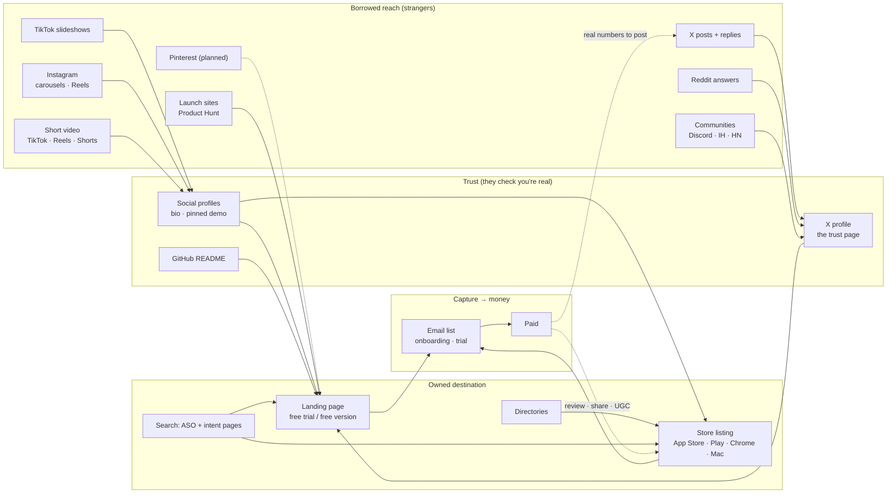
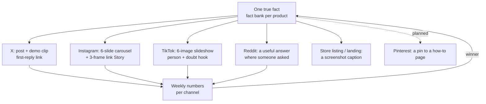
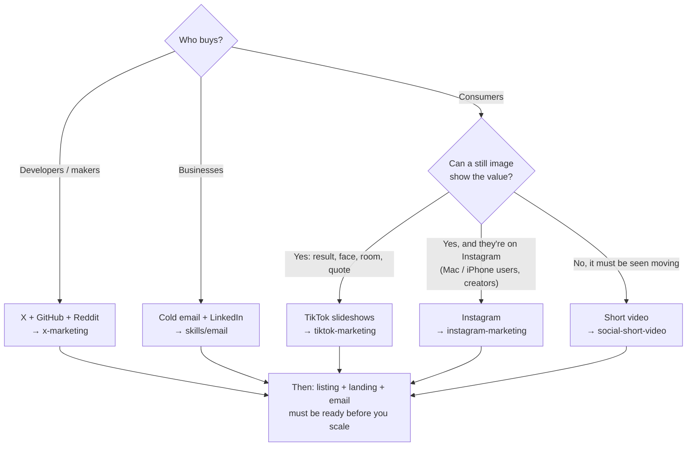

# Marketing & Social: every channel, and how they link

**Each social channel borrows strangers' attention. Profiles turn it into trust. Your landing page, store listing
and email list turn trust into users and money.** This page maps every channel kit in `marketing/` and every
channel skill in `skills/` onto that one chain, so you know where each fits, what it hands to the next step, and
which to start with.

```text
borrowed reach            trust                     owned destination              money
TikTok · Instagram · X  →  profile · pinned post  →  landing · store listing  →  email · trial  →  paid
Reddit · communities       bio link + UTM            directories · ASO             onboarding        ↺ reviews, shares
```

## The kits in this folder

| Channel | Kit | Start with | Content unit | Best for | Status |
|---|---|---|---|---|---|
| 🐦 X (Twitter) | [x-marketing/](x-marketing/README-X-Marketing.md) | [`/social-x`](x-marketing/skills/social-x/SKILL.md) | Short post + reply | Makers, early adopters, dev tools | Live |
| 📸 Instagram | [instagram-marketing/](instagram-marketing/README-Instagram-Marketing.md) | [`/social-instagram`](instagram-marketing/skills/social-instagram/SKILL.md) | Carousel, Reel, Story | Non-developer buyers, Mac / iPhone users, creators | Live |
| 🎞️ TikTok slideshows | [tiktok-marketing/](tiktok-marketing/README-TikTok-Marketing.md) | [`social-tiktok-slideshow`](tiktok-marketing/skills/social-tiktok-slideshow/SKILL.md) | 6-image photo-mode post | Consumer apps with a visual result or an emotional moment | Live |
| 📌 Pinterest | `pinterest-marketing/` | — | Pin → article / landing | Visual, evergreen search traffic | *planned* |

Every kit has the same layout: `README-<Channel>-Marketing.md`, `docs/` (the method), `reference/` (sources and
research log), `templates/`, `skills/`, plus `case-studies/`, `flow/` or `posts/` where the kit has them.

## 1 · The whole map



How to read it: left to right is one person's path. Each arrow is a link you must put in place (a bio link, a pinned
post, a CTA slide, a store URL), always with a UTM tag ([UTM map](#4--one-utm-map-for-every-channel)).

| Layer | Its only job | Kits / skills |
|---|---|---|
| **Reach** | Make strangers stop and care | TikTok, Instagram, X kits · [short video](../skills/social/social-short-video/SKILL.md) · [Reddit](../skills/launch/launch-reddit-posting/SKILL.md) · [Product Hunt](../skills/launch/launch-product-hunt-launch/SKILL.md) · [first 100 users](../skills/launch/launch-get-first-100-users/SKILL.md) |
| **Trust** | Prove you're real and the product works | [X profile funnel](x-marketing/skills/social-x-profile-funnel/SKILL.md) · Instagram [profile setup](instagram-marketing/docs/02-profile-setup.md) · [credible posting](../skills/social/social-credible-posting/SKILL.md) · [build in public](../skills/social/social-build-in-public/SKILL.md) · [GitHub seeding](../skills/launch/launch-github-repo-seeding/SKILL.md) |
| **Destination** | One clear next step | [Store listing by niche](../skills/listing/README.md) · [free directories](../skills/listing/listing-free-directories/SKILL.md) · [ASO](../skills/aso/README.md) · [screenshots](../skills/aso/aso-screenshot-strategy/SKILL.md) |
| **Capture → money** | Keep them and turn them into paid | [Email list](../skills/email/email-list-and-deliverability/SKILL.md) · [onboarding](../skills/email/email-onboarding-sequence/SKILL.md) · [trial emails](../skills/email/email-trial-sequence/SKILL.md) · [paywall](../skills/monetization/monetization-paywall-design/SKILL.md) |

A channel that gets views but no users is almost always a broken link **after** it: profile, landing or store page.
Fix the next layer before you post more.

## 2 · One fact, every channel (repurposing)

You don't need new ideas per channel. You need one true fact per product (a feature, a number, a user story) and
one adapter per channel.



| Fact type | X | Instagram | TikTok slideshow | Listing / landing |
|---|---|---|---|---|
| Visual result (before → after) | Demo clip | Carousel: before, steps, after | 6 slides, locked scene, person + doubt | Screenshot 1 |
| A number (time saved, users) | Number with context | Single image + caption | Hook: "My boss said…" + the number | Subtitle / proof line |
| A user story | Quote + reply to them | Carousel: their problem → result | "My mum couldn't…, so I showed her" | Review / testimonial (real only) |
| A how-to tip | Tip without product | Checklist carousel | Hook → 3–5 tips → CTA | Help page / intent page |

Templates: X [fact bank](x-marketing/templates/fact-bank.md) · Instagram [carousel brief](instagram-marketing/templates/carousel-brief.md) ·
TikTok [slideshow post](tiktok-marketing/templates/slideshow-post.md) and [hook bank](tiktok-marketing/templates/hook-bank.md).

## 3 · Which channel first?



Rules of thumb:
- **One main channel for 3 weeks**, one support channel at most. Add the next only when the first has a weekly routine
  you keep without thinking.
- **Before any channel:** the store listing ([listing by niche](../skills/listing/README.md)) and landing must convert,
  and there must be an email capture ([pre-launch checklist](../skills/launch/launch-pre-launch-checklist/SKILL.md)).
- **X is the trust page for everything else** when your buyers are makers: Reddit and email signatures point there
  ([cross-channel funnel](x-marketing/flow/cross-channel-funnel.md)).
- **Instagram and TikTok are reach for consumers**; they send people straight to the landing or store, not to X
  ([Instagram website funnel](instagram-marketing/flow/website-funnel.md)).

## 4 · One UTM map for every channel

Same pattern everywhere so one GA4 report compares channels: `utm_source=<channel>&utm_medium=<surface>&utm_campaign=<product or post>`.

| Channel | `utm_source` | `utm_medium` examples | Where the link lives |
|---|---|---|---|
| X | `x` | `bio`, `reply`, `post` | Bio, first reply under a post |
| Instagram | `instagram` | `bio`, `story`, `dm` | Bio links, Story link sticker, DM |
| TikTok | `tiktok` | `bio` | Bio only (caption links aren't clickable) |
| Reddit | `reddit` | `comment`, `profile` | Profile social links, comments where allowed |
| Email | `email` | `signature`, `onboarding`, `trial` | Signatures, sequences |
| Directories / launch sites | `<site>` | `listing`, `launch` | The listing page |
| Pinterest (planned) | `pinterest` | `pin` | The pin's destination link |

App stores strip most UTMs. For iOS use App Store Connect campaign links (`ct=`), for Google Play the `referrer`
parameter, and count installs per day per channel.

## 5 · One week, all channels (solo founder)

> **Illustrative example.** A plan for one person with ~6 hours a week; adjust to your main channel.

| Day | Main channel (pick one) | Support | Destination / money |
|---|---|---|---|
| Mon | 1–3 TikTok slideshows **or** 1 Instagram post **or** 2 X posts | 10 min Reddit answers | — |
| Tue | same | X replies 15 min | — |
| Wed | same | — | Fix one thing on the store listing or landing |
| Thu | same | Reddit answers | — |
| Fri | same | X replies | Check email sequence opens |
| Sat | batch next week's posts from the fact bank | — | — |
| Sun | weekly numbers per channel: [X](x-marketing/templates/weekly-numbers.md) · [Instagram](instagram-marketing/templates/weekly-numbers.md) · [TikTok loop](tiktok-marketing/skills/social-tiktok-slideshow-loop/SKILL.md) | — | Installs, trials, paid by `utm_source` |

## 6 · Same numbers in every channel

```text
reach (views / impressions) → engaged (saves · shares · replies) → profile visits → link clicks → installs / trials → paid
```

| Weak step | Usual cause | Fix with |
|---|---|---|
| Reach | Hook / first line | TikTok [hooks](tiktok-marketing/docs/03-hooks.md) · Instagram [image flow](instagram-marketing/skills/social-instagram-image-flow/SKILL.md) · X [post variants](x-marketing/docs/09-post-variants.md) |
| Profile visits | Post doesn't point anywhere | CTA slide with the product name · pinned post |
| Link clicks | Bio / pinned post | [X profile funnel](x-marketing/skills/social-x-profile-funnel/SKILL.md) · Instagram [profile setup](instagram-marketing/docs/02-profile-setup.md) |
| Installs | Store page or landing | [ASO screenshots](../skills/aso/aso-screenshot-strategy/SKILL.md) · [listing by niche](../skills/listing/README.md) |
| Paid | Onboarding / paywall | [Trial emails](../skills/email/email-trial-sequence/SKILL.md) · [paywall design](../skills/monetization/monetization-paywall-design/SKILL.md) |

## 7 · Rules that apply on every channel
- **Disclose** that you made or are paid to promote the product (TikTok, Instagram and X each have a setting or rule;
  FTC in the US). Details per kit: [X](x-marketing/docs/08-rules-and-risks.md) ·
  [Instagram](instagram-marketing/docs/08-rules-and-risks.md) · [TikTok](tiktok-marketing/docs/07-rules-and-risks.md).
- **Label realistic AI images.** Never present an AI result as a real customer or a real photo.
- **No fake engagement, no account networks run by one person or a bot.** Extra accounts are fine only as real,
  disclosed voices.
- **Never invent proof.** How to spot fake revenue screenshots: [fake proof and scams](x-marketing/reference/fake-proof-and-scams.md).

## Folder map

```text
marketing/
├── README-marketing-social.md      ← this page: the map and how channels link
├── x-marketing/                    X: daily posts, replies, profile funnel, Premium
├── instagram-marketing/            Instagram: 10-step image flow, Stories, growth engine, creators
├── tiktok-marketing/               TikTok: photo-mode slideshows, the Larry loop, case studies
└── pinterest-marketing/            (planned)

skills/  (channel-neutral skills these kits link to)
├── social/     short video · credible posting · build in public
├── launch/     Reddit · Product Hunt · first 100 users · GitHub seeding
├── listing/    store listing by niche · free directories
├── aso/        keywords · title · screenshots · ratings
└── email/      list · onboarding · trial · cold outreach
```

## Adding a channel kit
1. Create `marketing/<channel>-marketing/` with the layout above (no empty folders; mark missing parts *planned*).
2. Skills go in `marketing/<channel>-marketing/skills/<area>-<task>/SKILL.md`; the validator picks them up.
3. Add them to `.claude-plugin/marketplace.json`, the [social README](../skills/social/README.md), the router in
   [skills/growth](../skills/growth/SKILL.md), the root README, and a row + arrows on this page.
