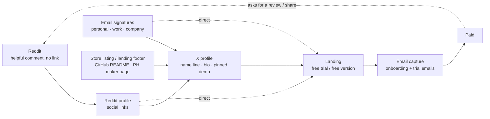

# Cross-channel funnel: every channel → X profile → free trial


**X is the trust page, the landing page is the action page.** People who meet you somewhere else (a Reddit comment, an
email, a store listing) check your X profile to see if you're real: recent work, demos, replies, numbers. Then they
click the bio link and start the free trial. So every channel you touch should point to both, with a UTM tag, and
the X profile has to turn that visit into a click.



Baseline to beat: in the real 28-day pattern ([analytics-pattern.md](analytics-pattern.md)) 2K impressions gave only
7 profile visits. Bringing people **to** the profile from other channels and making the profile convert are the two
levers this page covers.

---

## 1 · Reddit → X profile → trial (example route)

1. **Answer, don't advertise.** Find a thread where someone asks for what you built
   ([research-where-users-ask](../../../skills/research/research-where-users-ask/SKILL.md)). Write a useful answer that
   works even without your product: steps, a workaround, a comparison. Mention your app only if the subreddit allows
   it, and say "I built this" ([launch-reddit-posting](../../../skills/launch/launch-reddit-posting/SKILL.md)).
2. **Let the curious click your name.** Reddit profiles have *Social links* (up to 5 buttons under your name, separate
   from the bio; per Reddit's 2021 changelog). Add: X profile, landing page, LinkedIn. People who liked the answer
   click your name, see the X button, and check you out there.
3. **X profile closes the trust gap.** The pinned post shows the product working, the bio says who it's for and that
   there's a free trial / free version, the link carries `utm_source=x&utm_medium=bio`.
4. **Landing → free trial → email.** The landing repeats the same offer as the pinned post, and asks for an email
   before or right after the download ([email-trial-sequence](../../../skills/email/email-trial-sequence/SKILL.md)).
5. **Close the loop.** Happy users get one ask: a review or a reply in the thread where they found you.

> **Illustrative example.** Someone on a Mac subreddit asks how to find duplicate files. You answer with the Finder
> smart-folder trick and, where allowed, one line: "I built a small app for this, free to scan — disclosure, it's
> mine." Two people click your name, then your X button, watch the 20-second pinned demo, and download the free
> version from the bio link. The product, people and steps here show the route; they're not results.

**Don't:** post the same link in many subreddits, ask friends to upvote, DM people who didn't ask, or put the X link in
every comment. Those get removed or banned, and can push X to label your account too
([08-rules-and-risks.md](../docs/08-rules-and-risks.md)).

## 2 · Make the X profile convert (fix this first)

| Part | Do | Why |
|---|---|---|
| Name line | Name + the words buyers search: "Alex · Mac apps & Claude Code tools" (fictional) | X search reads the name, bio and posts |
| Bio | Who you help · what you made · one true proof · "free trial" / "free to try" | The visitor decides in seconds |
| Link | Hub page with `utm_source=x&utm_medium=bio&utm_campaign=profile` | You can see what X sends |
| Pinned post | 10–40 s demo + problem + offer ("free version, Pro $X once") | Sells while you sleep |
| Banner | Real screenshots of the products + one line | You can change it any time without losing the checkmark |
| Last 10 posts | Mostly demos, numbers and helpful replies, few links | Visitors scroll before they trust |

Full checklist: [02-profile-setup.md](../docs/02-profile-setup.md) ·
skill: [social-x-profile-funnel](../skills/social-x-profile-funnel/SKILL.md).

## 3 · Grow followers the clean way

- **Replies to the right accounts, every day.** 5–10 replies to accounts your buyers follow, each adds a fact,
  number or screenshot ([06-reply-playbook.md](../docs/06-reply-playbook.md)). In the real pattern, reply days were
  the reach days.
- **Talk with mutuals.** Replies between accounts that follow each other carry the most weight
  ([03-how-x-ranks-posts.md](../docs/03-how-x-ranks-posts.md)). Follow people you'd actually reply to.
- **Write things people send on.** Shares weigh far more than likes: checklists, free tools, honest numbers.
- **Point every other profile to X.** Reddit social links, GitHub profile and README, Product Hunt maker page,
  YouTube "links", LinkedIn "contact info", landing footer, email signatures.
- **One name everywhere.** Same photo, same handle where you can, same one-line pitch, so people recognise you.
- **Never:** follow/unfollow cycles, bought followers, "follow for follow" threads, giveaways for follows, automation.

## 4 · "SEO / ASO" for an X account

There's no store algorithm for X, but there are search surfaces you control:

| Surface | What to do |
|---|---|
| X search | The words buyers type in the name line, bio and post text ("Mac app", "screen recorder", "Claude Code") |
| Your landing / hub page | Footer links to X, Reddit, LinkedIn. If you use Organization or Person structured data, list the profiles in `sameAs` |
| Store listings | Developer website / support URL → your hub page, which links to X ([listing skills](../../../skills/listing/README.md)) |
| GitHub | Profile "social accounts" + README badges linking to X ([launch-github-repo-seeding](../../../skills/launch/launch-github-repo-seeding/SKILL.md)) |
| Directories | Many launch directories have a "maker X / Twitter" field: fill it ([listing-free-directories](../../../skills/listing/listing-free-directories/SKILL.md)) |

## 5 · Email signatures: yes, it's free traffic (a small, steady one)

Every email you send is seen by someone who already knows you. That's high trust and zero cost, but the volume is only
as big as the number of relevant emails you send, so treat it as a steady trickle, not a launch channel.

**Keep it in sync across addresses.** Same text, same order, only the UTM `utm_medium` changes per address, so you can
see which one sends visitors.

```text
{{Your name}} · I build small Mac apps and free tools
Try it free → https://example.com/?utm_source=email-signature&utm_medium=personal&utm_campaign=signature
X https://x.com/<handle> · Reddit https://www.reddit.com/user/<name> · LinkedIn https://www.linkedin.com/in/<name>
```

| Address | `utm_medium` | Note |
|---|---|---|
| Personal | `personal` | Full version above |
| Work (your own business) | `work` | Same, plus your role |
| Employer / company email | — | Follow your employer's signature policy. Don't promote side products there unless it's allowed |

How to set it up in Gmail: Settings → *See all settings* → *General* → *Signature* → *Create new*, then under
*Signature defaults* pick the address and which signature it uses for new mail and replies. Each address needs its
own default. Text links beat images: many mail apps block images by default.

## 6 · UTM map (one source per channel)

| Where the link lives | `utm_source` | `utm_medium` |
|---|---|---|
| X bio / pinned / first reply | `x` | `bio` / `pinned` / `reply` |
| Reddit profile social link | `reddit` | `profile` |
| Reddit comment (where allowed) | `reddit` | `comment` |
| Email signature | `email-signature` | `personal` / `work` |
| Email newsletter / sequence | `email` | `newsletter` / `trial` |
| GitHub README / profile | `github` | `readme` / `profile` |
| Store listing website field | `appstore` / `googleplay` / `chrome` | `listing` |

Check weekly which source brings **trials**, not just visits ([07-metrics-and-stop-rules.md](../docs/07-metrics-and-stop-rules.md)).

## 7 · Set it up in one afternoon

```text
[ ] X: name line with buyer words, bio with free-trial offer, UTM bio link, pinned demo
[ ] Reddit: social links → X, landing, LinkedIn
[ ] GitHub profile + top README: link to X and landing
[ ] Landing footer: X, Reddit, LinkedIn (+ sameAs if you use structured data)
[ ] Store listings: developer website → hub page
[ ] Gmail: one signature per address, same text, different utm_medium
[ ] Analytics: a saved view filtered by utm_source to compare channels every Sunday
```
